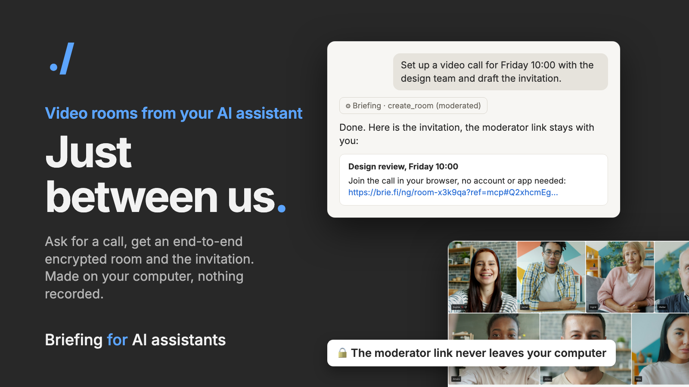

# Briefing for Claude

Create end-to-end encrypted [Briefing](https://brie.fi) video rooms (or chat rooms) from the conversation and invite people: Claude makes the room, puts the participant link into the email, calendar event or message it writes for you, and you join as moderator in your own browser.

## What it does

The plugin starts a local MCP server on your computer with six tools: `create_room`, `list_rooms`, `get_room_link`, `open_room`, `copy_room_link` and `forget_room`.

- A room exists only as its link, and the link is made on your computer. Nothing is registered anywhere, and the server sends nothing to Briefing or to anyone else.
- The rooms it made are kept in `rooms.json` in your app data folder (`~/Library/Application Support/briefing-mcp/` on macOS, `%APPDATA%\briefing-mcp\` on Windows, `~/.local/share/briefing-mcp/` on Linux), readable by your user account only.
- Claude gets at most the participant link, the one meant for invitations. Switch off "Let Claude see the participant link" and links only go to your clipboard and browser.
- The moderator link never goes to Claude. `open_room` hands it to your default browser, `copy_room_link` to your clipboard.
- Room names are random; a title you give stays on your computer.
- Links carry `?ref=mcp`, which the Briefing server counts per day, nothing else.

## What it runs

The plugin runs `npx -y briefing-video-chat-mcp@1.0.0`, a package pinned to an exact version that npx downloads from the npm registry once. The package is one file without runtime dependencies; its source is in [integrations/mcp](https://github.com/holtwick/briefing/tree/master/integrations/mcp). To open a link it runs your system's opener (`open`, `xdg-open` or `rundll32 url.dll,FileProtocolHandler`), to copy one your clipboard tool (`pbcopy`, `clip`, `wl-copy`, `xclip` or `xsel`). Needs Node.js 20 or later.

Local MCP servers run in Claude Code and in Cowork sessions on your computer, not in claude.ai chat. For Claude Desktop there is also an extension file (`.mcpb`), see the [source folder](https://github.com/holtwick/briefing/tree/master/integrations/mcp).

## Settings

- **Briefing server**: the official instance `https://brie.fi/ng/`, or your own Briefing server.
- **Let Claude see the participant link**: on by default.

## Privacy

[Briefing privacy statement](https://brie.fi/ng/_privacy), section 3.10. What Claude does with the participant link is governed by Anthropic's privacy policy.

## License

MIT, see [LICENSE](LICENSE).
